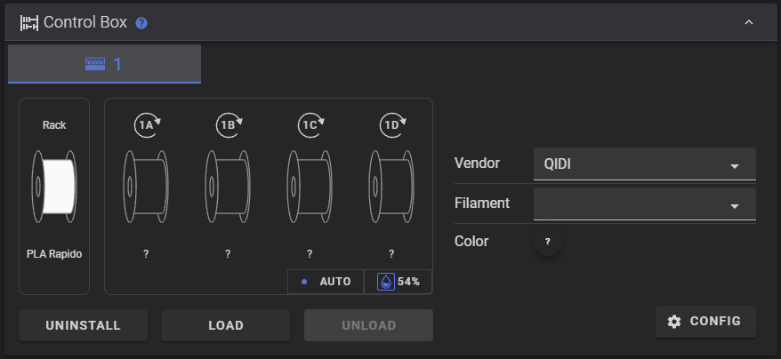
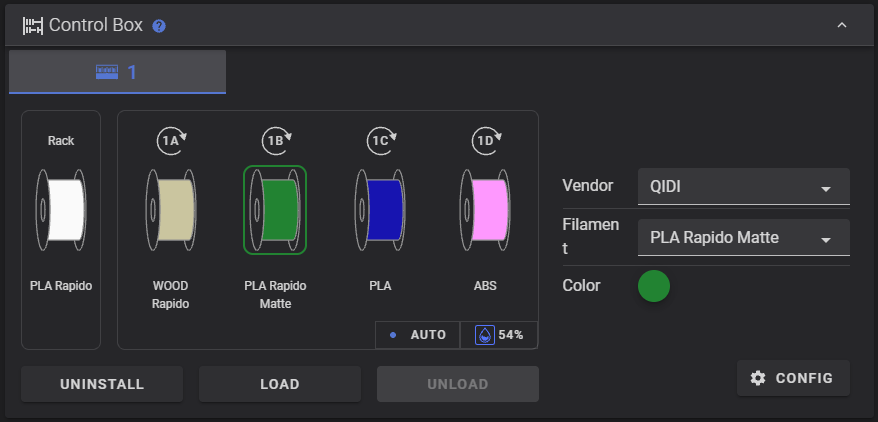

# QIDI Max4 – Fluidd box panel fix (firmware 01.01.07.01)

Unofficial fix for the **Material Control** (box / multi-colour) panel in Fluidd after the
**QD_MAX4 01.01.07.01** firmware update. Not affiliated with QIDI.

| Before: stock Fluidd after the update | After: with this fix |
|---|---|
|  |  |

## The problem

After updating to 01.01.07.01 the box works on the printer screen and in QIDI Studio, but in Fluidd:

- every box slot shows **`?`** instead of the material and colour,
- **Load / Unload / Eject** and the RFID read do nothing (the console reports an unknown command),
- changing vendor / material / colour in Fluidd writes data in the old format.

**Cause:** the update changed how slot materials are stored and renamed the box G-code commands,
but the Fluidd build shipped with it (v1.30.5) was never updated to match.

| | Before the update (what Fluidd expects) | After the update |
|---|---|---|
| `filament_slotN` | `7` (index in `officiall_filas_list.cfg`) | `"QFG00"` (filament ID) |
| `color_slotN` | `3` (index in a colour list) | `["060606"]` (hex list) |
| Eject | `E_BOX slot=N` | `EJECT_FILAMENT_CONTROL SLOT=N` |
| Load | `E_LOAD slot=N` | `LOAD_FILAMENT_CONTROL SLOT=N` |
| Unload | `E_UNLOAD slot=N` | `UNLOAD_FILAMENT_CONTROL SLOT=N` |
| RFID read | `RFID_READ SLOT=slotN` | `READ_RFID SLOT=N` |
| Change material | `SAVE_VARIABLE …` | `UPDATE_FILAMENT_INFORMATION SLOT=N COLOR='RRGGBB' VENDOR='QIDI' FILAMENT='PETG Basic'` |

One more problem: the new `multi_color_controller` object reports only *changed* fields in its status updates.
Fluidd replaces the whole object on every update, so after a few seconds it loses the "box filament is in the path"
flag (`b_endstop_state`). That is why **Unload** stays greyed out even with a slot loaded.

## What the fix does

The script patches two Fluidd files on the printer (`assets/index-*.js` and `sw.js`):

- slot material, vendor and colour come from `box_extras` (the same data QIDI Studio shows),
- Eject / Load / Unload / RFID send the new commands,
- changing vendor, material or colour sends `UPDATE_FILAMENT_INFORMATION`, the same command QIDI Studio sends.
  The vendor and material lists come from QIDI's new filament database, so you can only pick what the firmware knows,
  and the firmware sets the print temperatures itself,
- `multi_color_controller` updates are merged, so Unload is enabled when a slot is loaded,
- `sw.js` gets a new revision so browsers load the patched file instead of a cached one.

The external spool (Rack) still works the old way. Nothing in Klipper, Moonraker or the printer config is changed.

## Compatibility

- QIDI Max4, firmware **QD_MAX4 01.01.07.01** (release 2026-10-16) with the Fluidd v1.30.5 shipped in it.
- The script checks every place it changes. On any other Fluidd build it stops **without changing anything**.
- Tested on one printer with one QIDI Box (box firmware 02.03.01.21) and spools without RFID tags.
  **Not tested:** several boxes, the RS485 box, RFID-tagged spools. Feedback is welcome in the Issues.

## Install

You need SSH access to the printer. The factory default login on the Max4 is user `qidi`, password `qiditech`
(if you changed it, use your own).

**1. Copy the script to the printer.** Choose one:

- **a)** In Fluidd go to **Configuration**, upload `qidi_fluidd_box_fix.py`. It lands in `~/printer_data/config/`.
- **b)** Download it directly over SSH:
  ```bash
  curl -fsSL -o ~/qidi_fluidd_box_fix.py https://raw.githubusercontent.com/Assur92/qidi-max4-fluidd-box-fix/main/qidi_fluidd_box_fix.py
  ```

**2. Run it over SSH** (use the path where you put the script):

```bash
sudo python3 ~/printer_data/config/qidi_fluidd_box_fix.py
```

You can check first without changing anything:

```bash
python3 ~/printer_data/config/qidi_fluidd_box_fix.py --dry-run
```

If `python3` is not found, use Klipper's Python instead: `sudo ~/klippy-env/bin/python …` with the same arguments.

The script saves the original files as `*.orig` next to them. If you used option a), you can delete the script
from Configuration afterwards.

**3. Reload Fluidd.** Close **every** Fluidd tab, open Fluidd again and press **Ctrl+F5**.
On a phone, close the tab and open the page again. A plain refresh is not enough, because Fluidd's service worker keeps
the old version while any Fluidd tab is open.

## Undo

```bash
sudo python3 ~/printer_data/config/qidi_fluidd_box_fix.py --restore
```

Then close the Fluidd tabs, reopen and press Ctrl+F5 again.

## After the next QIDI update

A firmware update will probably replace Fluidd and remove the fix. Run the script again.
If QIDI changed Fluidd, the script stops without changing anything. Then either QIDI fixed it,
or the script needs an update (open an Issue).

## Limitations

- The material list comes from the database for the 0.4 mm nozzle (56 entries, the full list).
  The 0.2 mm database has only 29 entries, so with a 0.2 nozzle some materials may have no profile.
- Printing from Fluidd's own slot-mapping dialog still uses the old data. Start multi-colour prints from QIDI Studio.
- QIDI's own macros `M603` / `M604` in `klipper-macros-qd/filament.cfg` still call the removed `E_LOAD` / `E_UNLOAD`.
  That is a bug in the QIDI update itself; this script does not touch it.

## Disclaimer

Unofficial. You change files on your own printer at your own risk. QIDI may treat modified system files as
unsupported. The script backs up the original files and can restore them.

## License

GPL-3.0, the same as [Fluidd](https://github.com/fluidd-core/fluidd), which this patches.
